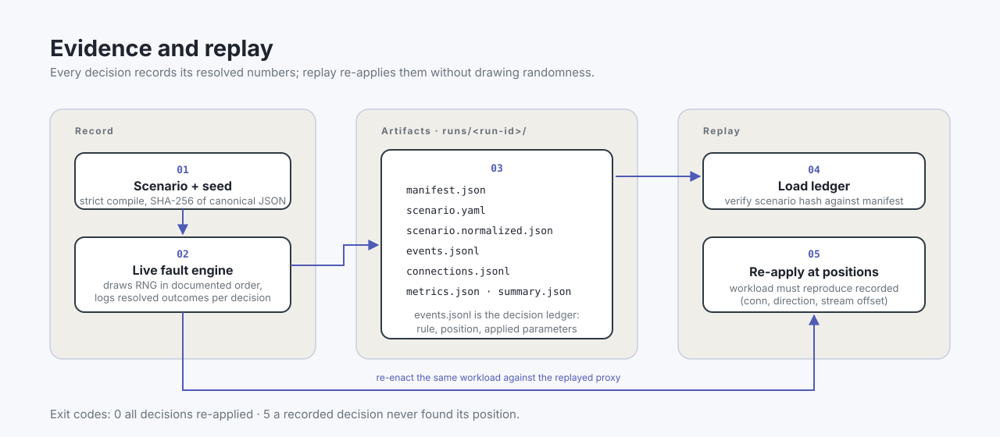

# Loki

A deterministic TCP and UDP fault-injection proxy for failures that only
appear when communication goes wrong.



A scenario and one seed control six faults: delay, throttle, fragment,
reorder, duplicate, and corrupt.
Every resolved decision (the sampled delay, the fragment sizes drawn, the
permutation chosen) is recorded in an evidence directory so the run can be
inspected and replayed byte-for-byte.

## Boundary

Loki changes application byte streams and UDP datagrams.
It does not simulate IP packets, routing, MTU behavior, congestion control, or
kernel queues.

The implementation is V1: pre-1.0, one I/O thread per proxy process.

## Why replay works

- One RNG stream per run, seeded from the scenario; draws happen only inside
  the fault engine, in a documented order.
- The scheduler orders events by `(deadline_us, seq)`; wall-clock timestamps
  are recorded but never affect decisions.
- `stream_offset` always refers to the pristine logical byte stream of a
  direction, before mutation; matching sees pristine positions.
- The ledger carries resolved parameters, so replay re-applies recorded
  decisions without re-drawing randomness.
- The canonical normalized scenario JSON is SHA-256 hashed and appears in
  every artifact of the run.

## Build and verify

```sh
./scripts/build.sh              # configure default preset, build, ctest
./scripts/build.sh asan         # sanitizer configuration when needed
```

Requirements: CMake 3.25+, a C++20 compiler, Make. Catch2 v3.8.1 is fetched at
configure time for tests.

## Run

```sh
loki run scenarios/basic.yaml --seed 123
loki validate scenarios/composite.yaml
loki replay runs/<run-id> --check-only
loki inspect runs/<run-id> --events --tail 50
```

Each run writes `manifest.json`, `scenario.yaml`, `scenario.normalized.json`,
`events.jsonl`, `connections.jsonl`, `metrics.json`, and `summary.json` under
`runs/<run-id>/`.

## Documentation

- [GUIDE.md](GUIDE.md) - build, scenarios, commands, replay, limitations
- [docs/UDP.md](docs/UDP.md) - datagram mapping and semantics
- [docs/BENCHMARKS.md](docs/BENCHMARKS.md) - benchmark evidence policy and the labeled historical snapshot
- [docs/ROADMAP.md](docs/ROADMAP.md) - what is deliberately not implemented yet

## Limitations

- Single I/O thread per process; no worker pool.
- No TLS awareness: encrypted traffic is proxied opaquely and cannot be
  matched or shaped at the application layer.
- No connection lifecycle faults (no reset, FIN, or refusal injection); the
  fault vocabulary is byte/datagram shaping only.
- Reordering happens between Loki's logical pieces, not network packets.
- No current throughput or latency number is published; the historical
  snapshot in docs/BENCHMARKS.md is context, not evidence.

## License

Loki is released under the [MIT License](LICENSE).
